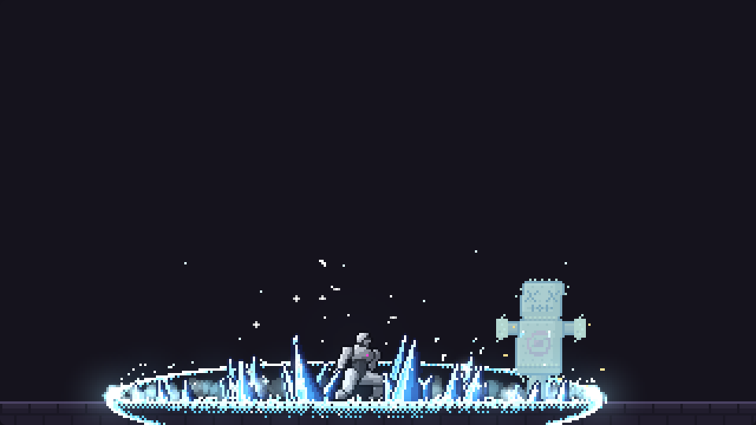

# pixelfx · витрина

Маленькая демо-страница, чтобы потрогать приёмы пиксельной графики из
[patch-gg/pixelfx](https://github.com/patch-gg/pixelfx): эффект — не картинка, а программа, которая рисует
в два буфера (цвет + аддитивный свет), детерминирована по `seed`, красится одной рампой и играется «актом»
с замахом, стоп-кадром на контакте и восстановлением.

Разбор самих приёмов — в
[`pixel-art-fx.md`](../../.agents/skills/arena-game-forge/references/pixel-art-fx.md).



## Запуск

Нужен любой статический сервер (ES-модули не грузятся с `file://`):

```bash
python3 -m http.server 8010 --bind 0.0.0.0 -d demos/pixel-fx
# открыть http://127.0.0.1:8010/
```

Ни сборки, ни зависимостей, ни интернета: рантайм и эффекты лежат рядом, в `vendor/pixelfx/`.

## Что можно потрогать

| Действие | Что показывает |
|---|---|
| клик по сцене | эффект срабатывает в точке клика (якорь прижимается к краям сцены) |
| «Эффект» | 13 штук в 8 категориях: мечи, приёмы, магия, удары, взрывы, огонь, предметы, погода, интерфейс |
| «Палитра» | один и тот же код становится огнём, льдом, ядом, светом, тьмой, неоном, матрицей |
| «Другой дубль» | новый `seed`: та же программа, другой рисунок, но всегда воспроизводимый |
| «Тело и акт» | включает акт: тело, цель-соломенное чучело, freeze на контакте, тряска |
| «Хост-hit-stop» | без тела сцена сама замирает на кадре удара — тайминг взят из данных эффекта |
| «Спрайт-лист» | те же кадры в PNG-сетке + `pivot` и fps, как у `node tools/render.mjs <id> --sheet` |
| «Тайминг акта» | JSON для игры с собственным героем: `windup`, `recovery`, `hits[].t/freeze/shake/push/skin` |

Под сценой — таймер стоимости кадра. В headless-браузере он считается на софтверном рендере (обычно
1.5–4 мс); планка pixelfx — до 2 мс на эффект на обычном железе.

## Как это устроено

```text
index.html      разметка и тексты
style.css       тёмная панель вокруг сцены
app.js          вся логика: цикл, акт, hit-stop, палитры, спрайт-лист, тестовые хуки
vendor/pixelfx/ рантайм (core/) и нужные эффекты (fx/) — MIT, см. LICENSE и NOTICE.md
```

Ключевые места в `app.js`:

1. **Один буфер на всю игру.** `createFrame(320, 180)` и один `ImageData`, `clearFrame` каждый кадр,
   `composite(frame, img.data, bg)` в конце — цвет, затем аддитивный свет.
2. **Сцена — 320×180 арт-пикселей**, апскейл целым множителем (до 3×) через `canvas.style.width`,
   `image-rendering: pixelated`. На узком экране масштаб меньше 1×, чтобы не мылить картинку.
3. **Эффект без тела** живёт как `createFx(mod, { x, y, seed, palette })`: `draw(frame, "back")` →
   персонаж → `draw(frame, "front")`.
4. **Эффект с телом** — `createAct(mod, …)`: он сам рисует героя и цель, держит паузу на контакте и отдаёт
   смещение тряски через `inst.shake`.
5. **Хост-hit-stop.** Когда акт выключен, сцена морозит себя на `hits[i].freeze` секунд — так же это делает
   игра со своим персонажем, читая `actTiming(mod)`.
6. **Спрайт-лист** строится тем же кодом: `createFx` рисуется в собственный канвас эффекта, фон —
   прозрачный (`composite(..., null)`), кадры кладутся сеткой 10 в ряд.

## Тестовые хуки

Для скриншотов и проверок страница выставляет `window.__DEMO__`:

```js
__DEMO__.select("ice/frost-nova");   // или индекс в списке
__DEMO__.palette("лёд");             // "родная" | "огонь" | "лёд" | "яд" | "свет" | "тьма" | "неон" | "матрица" | "золото" | "металл"
__DEMO__.body(false);                // выключить акт и тело
__DEMO__.seed(1234);
__DEMO__.sheet();                    // открыть и построить спрайт-лист
```

## Ограничения

- Спрайт-лист содержит **только эффект**: тело, цель и тряска — это акт, в игре его играет ваш герой.
- Шит — PNG без JSON-метаданных: `fps`, `pivot` и число кадров подписаны рядом. Полный атлас с
  `meta.pixelfx` делает `node tools/render.mjs <id> --sheet` в самом pixelfx.
- Красителей два: рампа и `seed`. Реколор по пикселю, вращение и зеркало доступны только в живом
  рендере (`flip`, `angle` в опциях `createFx`), но в витрину они не выведены.
- Диапазон палитр и эффектов выбран под сцену 320×180; совсем крупные эффекты (большие взрывы,
  переходы на весь экран) сюда не помещаются без своего канваса.

## Лицензия

`vendor/pixelfx/` — MIT, Copyright (c) 2026 Patch и участники, часть эффектов адаптирована из
Sprite Fusion (Hugo Duprez, MIT) и Hollow Crown (MIT); подробности в `vendor/pixelfx/LICENSE` и
`vendor/pixelfx/NOTICE.md`. Шрифт Patch Pixel из оригинального репозитория сюда не входит.
