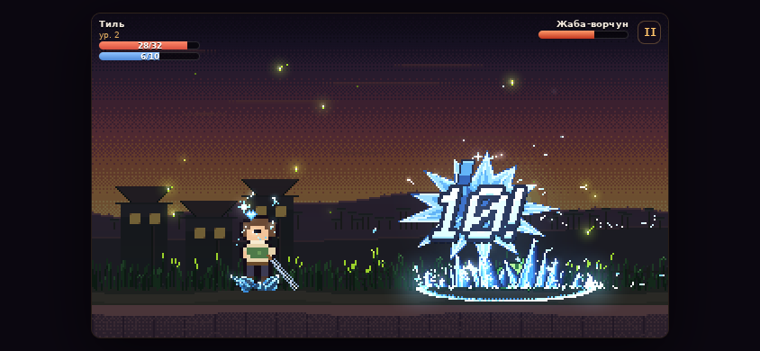

# Тихий закат

Пошаговый пролог JRPG для Android-браузера. Тёплая сказка: деревня Тихая Падь на закате, парень Тиль с
отцовским мечом, слайм на околице и жаба в канаве. Пять–семь минут игры, два боя, первый уровень.

Сделан по контракту из брейншторма (см. «Решение по этапам» ниже) и на методе pixelfx: **анимация — это
маленькие программы в двух буферах**, а не картинки. Разбор метода —
[`pixel-art-fx.md`](../../.agents/skills/arena-game-forge/references/pixel-art-fx.md), живая витрина —
[`demos/pixel-fx/`](../../demos/pixel-fx/README.md).



## Запуск

```bash
python3 -m http.server 8010 --bind 0.0.0.0 -d games/quiet-dusk
# открыть http://127.0.0.1:8010/ и повернуть телефон горизонтально
```

Без сборки, без зависимостей, без сети после первой загрузки: `manifest.webmanifest` + `sw.js` кэшируют
всё, из браузера Android игру можно «добавить на главный экран» и играть офлайн.

## Что в прологе

| Шаг | Что происходит |
|---|---|
| Титул | «Начать пролог»; если есть сохранение — «Продолжить» |
| У дома | три реплики бабули Нисы и Тиля (тап по реплике — дальше) |
| Бой 1 | **Слайм**: атака мечом, подсказки хода, гарантированная победа |
| Победа | опыт заливает полосу, **уровень 2**, экран «Выучен Ледяной шип» |
| Бой 2 | **Жаба-ворчун**: лёд бьёт её сильнее, у неё есть тяжёлый удар каждый третий ход |
| Поражение | не Game Over, а «Ты очнулся дома»: HP/MP полные, зелье вернулось, бой заново |
| Финал | «Продолжение следует» + сохранение пройденного этапа |

Команды в бою: **Атака** (меч), **Ледяной шип** (4 MP, открывается на 2 уровне), **Лечение** (5 MP),
**Зелье** (одно на пролог). MP не восстанавливается в бою — это и есть ресурсное решение.

## Как это анимировано

Всё, что «сочное» в бою, — эффекты pixelfx, вендоренные в `src/vendor/pixelfx/` (MIT):

- `melee/sword-slash` — дуга взмаха, летит от руки в сторону врага;
- `impacts/crit-hit` — вспышка крита, `ui/damage-number` и `ui/crit-number` — цифры урона;
- `ice/frost-nova` — «Ледяной шип» (реколор в голубую рампу, `reach` под арену);
- `holy/heal` — лечение; `ui/level-up` — экран нового уровня;
- `critters/slime` и `critters/frog` — враги; `weather/fireflies` — светлячки над деревней;
- `transitions/star-iris` — переход в бой.

Ритм удара — по методу: **замах → 1–2 кадра вспышки → стоп-кадр всего мира → follow-through**.
Стоп-кадр и тряска живут в одном месте:

```js
function hitStop(sec, amp) {
  world.freeze = Math.max(world.freeze, sec);       // весь мир стоит, пока freeze > 0
  if (amp) { world.shake0 = world.shake = Math.max(0.18, sec * 2.6); world.amp = amp; }
}
```

Герой нарисован своими руками (`src/art.js`): 12×20 строк-спрайт, масштаб ×2, позы `idle / windup / strike /
cast / hurt / potion`, меч считается от кисти — в покое остриё упирается в землю, в замахе заносится назад,
в ударе идёт вперёд-вниз. Враг «дышит» своим эффектом, трясётся от попадания и вспыхивает белым.

Сцена — **320×180 арт-пикселей** на всю игру: один `createFrame`, один `ImageData`, `composite()` в конце
кадра (цвет + аддитивный свет), апскейл целым множителем (до 3×) с `image-rendering: pixelated`.

## Решение по этапам (брейншторм)

| Этап | Вопрос | Ответ |
|---|---|---|
| 1 | Чем открывается игра | деревня на закате |
| 1 | Тон мира | тёплая сказка |
| 1 | Что доминирует в бою | зрелищность (замах, стоп-кадр, криты) |
| 2 | Как держать телефон | ландшафт, кнопки внизу |
| 2 | Объём пролога | бой + уровень + второй враг |
| 2 | Сложность | можно проиграть, мягкий рестарт |
| 3 | Контракт | утверждён как есть |

## Устройство

```text
index.html      разметка: сцена-канвас + HUD/реплики/команды/карточки поверх
styles.css      тёмная рамка вокруг сцены, крупные кнопки под палец
src/game.js     пролог, бой, hit-stop, карточки, сохранение, тестовые хуки
src/art.js      закат-фон, герой и его позы, меч, тень, вспышка попадания
src/vendor/     pixelfx: core/ (рантайм) + fx/ (нужные эффекты), MIT
sw.js, manifest.webmanifest, icon.svg, cover.svg
qa/             скриншоты прогонов в headless-браузере
```

## Тестовые хуки

Игра выставляет `window.__QUIET_DUSK__` — им удобно гонять её скриптом в headless-браузере:

```js
__QUIET_DUSK__.state                    // фаза, HP/MP, враг, сохранение
__QUIET_DUSK__.card() / .talk()         // что открыто сейчас
__QUIET_DUSK__.press("attack" | "skill" | "heal" | "potion" | "talk")
__QUIET_DUSK__.cardPress("Начать пролог")
__QUIET_DUSK__.fight("frog")            // сразу в бой
__QUIET_DUSK__.setHp(3)                 // проверить мягкий рестарт
__QUIET_DUSK__.probe(70, 100, 130, 175) // bbox и число пикселей в буфере кадра
```

## Проверено (headless Chromium, SwiftShader)

- полный пролог без ошибок консоли: титул → 4 реплики → бой со слаймом → победа → 2 уровень → бой с жабой →
  финал, плюс поражение и мягкий рестарт (HP/MP/зелье восстановлены, враг тот же);
- ландшафт 844×390 и 915×412: масштаб 2×, нет горизонтального скролла; портрет 390×844: 1× и подсказка
  «поверните телефон»;
- попадания и лечение проверены по буферу кадра (`probe`), а не на глаз: после удара в области врага растут
  пиксели, у героя появляется вспышка.

## Ограничения (честно)

- Музыки и звуков нет: только визуальный «джус». WebAudio сознательно не трогал в этом срезе.
- Один сюжетный путь, нет инвентаря (кроме одного зелья), нет карты и ходьбы по деревне.
- Сохранение — только пройденный этап в `localStorage`, боёв и характеристик не хранит.
- Портрет — только аварийный режим 1× (игра задумана в ландшафте).
- Враги — готовые эффекты pixelfx (`critters/slime`, `critters/frog`): у них своя хореография, а не атаки
  по команде; их «выпад» — сдвиг якоря эффекта, а не отдельная анимация.

## Лицензия

Код игры — как и репозиторий. `src/vendor/pixelfx/` — MIT, Copyright (c) 2026 Patch и участники; часть
эффектов адаптирована из Sprite Fusion (Hugo Duprez, MIT) и Hollow Crown (MIT) — см. `LICENSE` и
`NOTICE.md` внутри вендоренной папки.
